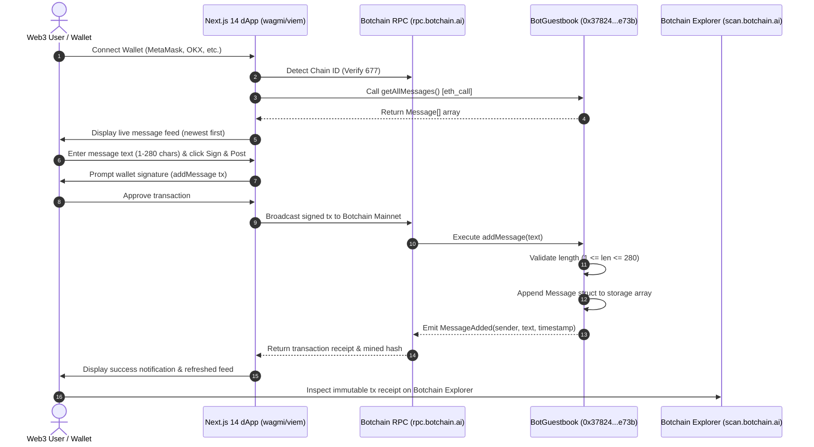

# BotGuestbook 🤖📖 — Whitepaper & Pitch Deck

> **Project Name**: BotGuestbook  
> **Network**: Botchain Mainnet (Chain ID `677`)  
> **Smart Contract Address**: [`0x37824B3E16B68dBcF34c9e05BB9a042d952ee73b`](https://scan.botchain.ai/address/0x37824B3E16B68dBcF34c9e05BB9a042d952ee73b)  
> **Block Explorer**: [https://scan.botchain.ai](https://scan.botchain.ai)  
> **RPC Endpoint**: `https://rpc.botchain.ai`  
> **Native Token**: BOT (Total Supply: 150 Million)  
> **Repository / Codebase**: [liljhnxn/botguestbook](file:///c:/Users/PROGRESSIVE/Documents/Isaac%20work/Work%2020)  
> **License**: MIT  

---

## 📑 Part 1: Official Whitepaper

### 1. Executive Summary
**BotGuestbook** is a decentralized, public, on-chain social guestbook protocol and decentralized application (dApp) built natively on **Botchain Mainnet**. In an era dominated by centralized social feeds, platform censorship, algorithmic feed manipulation, and ephemeral digital footprints, BotGuestbook provides a tamper-proof, immutable, and permanent public messaging canvas.

By leveraging the high throughput, EVM compatibility, and micro-transaction fees of Botchain Mainnet, users connect their Web3 wallet and etch short messages (up to 280 characters) directly into blockchain storage. Each entry permanently binds the user's cryptographic address to their statement alongside an unalterable block timestamp. BotGuestbook serves as a benchmark architectural model for Web3 social permanence, decentralized community attendance, event guestbooks, and transparent public registries.

---

### 2. Problem Statement
Contemporary digital communication platforms suffer from core structural flaws that compromise permanence, sovereignty, and data ownership:

1. **Centralized Erasure & Censorship**: Traditional guestbooks, blog comments, and microblogging platforms operate on closed database architectures. Messages, reviews, and greetings can be silently deleted, retroactively edited, or suppressed by platform gatekeepers without recourse.
2. **Algorithmic Feed Distortion**: Centralized social media relies on proprietary engagement algorithms that hide or prioritize posts based on commercial incentives rather than chronological honesty or user agency.
3. **Impersonation & Lack of Authorship Integrity**: Web2 social accounts rely on passwords and arbitrary usernames prone to credential theft, account takeovers, and fraudulent impersonation. In contrast, cryptographic proofs ensure that message authorship cannot be forged.
4. **Data Ephemerality & Platform Decay**: When Web2 platforms shut down, change APIs, or monetize archives, millions of historical social records, community milestones, and personal messages vanish forever.
5. **High EVM Gas Barriers on Legacy L1s**: Attempting to record messages directly on legacy chains (such as Ethereum Mainnet) incurs prohibitively high gas fees (often $5–$50 per message), rendering everyday decentralized social interactions economically impractical.

---

### 3. The BotGuestbook Solution
BotGuestbook solves these limitations by combining a gas-optimized smart contract on **Botchain Mainnet** with an intuitive, cyberpunk-inspired Web3 interface:

- **Immutable On-Chain Ledger**: Every message submitted through BotGuestbook is written directly to the state storage of the [BotGuestbook.sol](file:///c:/Users/PROGRESSIVE/Documents/Isaac%20work/Work%2020/contracts/BotGuestbook.sol) smart contract. Once mined in a block, the entry can never be pruned, modified, or silenced.
- **Cryptographic Authorship**: Every message is authenticated via cryptographic signature from the sender's EVM wallet address (`msg.sender`). Identity is transparent, verifiable, and tied to public key cryptography.
- **Timestamp Fidelity**: Each message is anchored to the decentralized consensus clock via `block.timestamp`, providing indisputable chronological proof of when the message was recorded.
- **Transparent Chronological Feed**: Messages are cataloged sequentially and exposed via public getters and event streams, preserving an unfiltered, chronological timeline without algorithmic interference.
- **Sub-Second Finality & Micro-Fee Execution**: Botchain Mainnet provides sub-second transaction settlement and micro-gas execution costs, making continuous on-chain microblogging seamless and affordable.

---

### 4. Technical Architecture & System Mechanics

#### 4.1 Smart Contract Architecture
The protocol is driven by [BotGuestbook.sol](file:///c:/Users/PROGRESSIVE/Documents/Isaac%20work/Work%2020/contracts/BotGuestbook.sol), written in Solidity `^0.8.24`. The contract is intentionally lean, self-contained, and devoid of external administrative backdoors, pause mechanisms, or upgradeable proxy complexities.

```solidity
struct Message {
    address sender;
    string text;
    uint256 timestamp;
}

uint256 public constant MAX_MESSAGE_LENGTH = 280;
Message[] public messages;
```

#### 4.2 Core State Functions
- `addMessage(string calldata text)`: 
  - Validates that `bytes(text).length > 0` (preventing zero-length spam).
  - Validates that `bytes(text).length <= MAX_MESSAGE_LENGTH` (enforcing the 280-character ceiling to prevent state bloat).
  - Stores a new `Message` struct in the dynamic array with `msg.sender`, the message string, and `block.timestamp`.
  - Emits the `MessageAdded(address indexed sender, string text, uint256 timestamp)` event for real-time frontend indexing.
- `getMessageCount() external view returns (uint256)`: Returns the total count of messages stored.
- `getMessage(uint256 index) external view returns (address, string memory, uint256)`: Retrieves an individual message by index.
- `getAllMessages() external view returns (Message[] memory)`: Returns all entries in a single batch read, drastically reducing RPC round-trips for the frontend.

#### 4.3 End-to-End Interaction Flow



---

### 5. Botchain Mainnet Integration & Economic Viability

| Parameter | Specification | Purpose & Benefit |
| :--- | :--- | :--- |
| **Network Name** | Botchain Mainnet | High-speed, EVM-compatible execution layer |
| **Chain ID** | `677` | Prevents replay attacks across EVM ecosystems |
| **Native Token** | `BOT` (18 decimals) | Used for micro-gas payments on writes |
| **Total Supply** | 150 Million BOT | Fixed, predictable tokenomics |
| **RPC Endpoint** | `https://rpc.botchain.ai` | High-availability JSON-RPC communication |
| **Block Explorer** | [https://scan.botchain.ai](https://scan.botchain.ai) | Public transaction and address auditability |
| **Average Gas per Write** | ~65,000 - 85,000 gas | Extremely cost-effective (< $0.001 equivalent) |
| **Block Finality** | Fast block creation | Instant user feedback and message publication |

---

### 6. Security Analysis & Automated Testing

#### 6.1 Attack Vector Hardening
- **Reentrancy Immunity**: The contract does not transfer ETH/BOT tokens or call untrusted external contracts; all storage writes occur synchronously.
- **State Bloat Protection**: The strict `MAX_MESSAGE_LENGTH` limit (280 bytes) prevents malicious actors from consuming excessive blockchain state storage with large payloads.
- **Zero-Length Input Reversion**: Calling `addMessage("")` immediately reverts with `"Message cannot be empty"`, saving gas by rejecting empty transactions upfront.
- **Decentralized Ownership**: No admin keys, pausable toggles, or upgrade proxies exist. The smart contract is truly autonomous and cannot be shut down or censored by anyone, including the deployer.

#### 6.2 Test Suite Verification
The protocol is accompanied by a full automated test suite ([test/BotGuestbook.ts](file:///c:/Users/PROGRESSIVE/Documents/Isaac%20work/Work%2020/test/BotGuestbook.ts)) utilizing Hardhat, ethers.js, and Chai:
- **Deployment Verification**: Confirms initialization at 0 messages and verifies `MAX_MESSAGE_LENGTH = 280`.
- **Message Integrity**: Validates sender address assignment, text preservation, and block timestamp accuracy.
- **Validation Constraints**: Tests that empty messages revert (`"Message cannot be empty"`), strings exceeding 280 chars revert (`"Message exceeds maximum length"`), and exactly 280-character messages succeed.
- **Multi-User State**: Verifies multiple distinct wallet signers submitting messages with preserved sequence and accurate global counters.
- **Event Emittance**: Confirms `MessageAdded` events are emitted with exact indexed sender, text payload, and timestamp parameters.

---

### 7. Ecosystem Roadmap

```text
Phase 1: Foundation (Current - Live)
├── Core BotGuestbook.sol deployed & verified on Botchain Mainnet
├── Automated test suite (100% coverage across core flows)
├── Next.js App Router dApp with wagmi/viem integration
└── Cyberpunk Web3 aesthetic & responsive mobile layout

Phase 2: Social & Media Enhancements
├── IPFS / Arweave content hashing for decentralized media attachments
├── Native BOT Tip Jar (send micro-tips directly with message entries)
├── Markdown & emoji parser for rich message formatting
└── Upvote / reaction attestations signed by wallet holders

Phase 3: Web3 Identity & Community Protocol
├── Botchain Name Service (.bot) / ENS resolution on user avatars
├── Guestbook Factory Protocol (spin up private or DAO-specific guestbooks in 1 click)
├── Soulbound Token (SBT) / Proof-of-Attendance (POAP) minting for guestbook signers
└── Subgraph indexing for ultra-fast historical search & analytics
```

---

## 📊 Part 2: 10-Slide Pitch Deck

### Slide 1: Cover & Vision
- **Title**: BotGuestbook
- **Subtitle**: Immutable Public Messaging & Web3 Social Presence on Botchain Mainnet
- **Key Takeaway**: A censorship-resistant, decentralized on-chain guestbook where digital messages are preserved permanently on the blockchain.
- **Deployed Contract**: `0x37824B3E16B68dBcF34c9e05BB9a042d952ee73b` (Botchain Mainnet)

---

### Slide 2: The Problem
- **Fragile Web2 Social Footprints**: Centralized comment platforms and social feeds delete, alter, or monetize personal and community records.
- **Censorship & Algorithmic Filtering**: Users have no sovereignty over their content; algorithms dictate visibility.
- **Identity Fraud & Opaque Authorship**: Usernames are easily impersonated without cryptographic proof of origin.
- **High Gas Barriers**: Legacy L1 blockchains make decentralized posting economically unfeasible for everyday users.

---

### Slide 3: The Solution
- **Permanent On-Chain Storage**: Every message is an immutable transaction recorded directly in smart contract state.
- **Cryptographic Authorship**: Only the private key holder can author a message from their address.
- **Zero Censorship / No Backdoors**: No admin keys, no delete buttons, and no algorithmic bias.
- **High-Speed, Micro-Fee Experience**: Powered by Botchain Mainnet for sub-second block creation and negligible gas costs.

---

### Slide 4: Key Features & Product Demo
- **Simple 280-Character Canvas**: Familiar microblogging constraint optimized for gas efficiency.
- **Live Chronological Feed**: Messages render in real-time, sorted newest-first with direct links to Botchain Explorer.
- **One-Click Network Switching**: Automatically detects Botchain Mainnet (`Chain ID 677`) and configures MetaMask/Web3 wallets seamlessly.
- **Graceful Fault Tolerance**: Built-in fallback alerts inform users if network conditions or contract addresses require configuration.

---

### Slide 5: System Architecture & Technical Stack
- **Smart Contract Layer**: Solidity `^0.8.24` compiled with Paris EVM target and 200 optimization runs.
- **Frontend Architecture**: Next.js 14 (App Router), TypeScript, Tailwind CSS.
- **Web3 Connectivity**: wagmi v2, viem v2, and TanStack React Query for efficient RPC caching.
- **Tooling & Testing**: Hardhat, Ethers.js, Chai test runner, Lucide React icons.

---

### Slide 6: Security, Gas Optimization & Testing
- **Gas Optimized**: Uses `string calldata` input parameter and compact storage packing.
- **Input Guardrails**: Rejection of empty strings and length capping at 280 characters.
- **Zero Reentrancy Surface**: No external value transfers or untrusted contract calls.
- **Comprehensive Unit Tests**: Full coverage testing message creation, edge cases, boundaries, and event emissions.

---

### Slide 7: Why Botchain Mainnet?
- **High Throughput**: Rapid block generation enables immediate transaction feedback without UI stalling.
- **Micro-Cent Gas Fees**: Users can post dozens of entries with negligible BOT gas costs.
- **EVM Compatibility**: Standard tooling (Hardhat, wagmi, viem) works out of the box without proprietary SDK friction.
- **Transparent Explorer**: Real-time contract verification and transaction inspection via Botchain Explorer (`https://scan.botchain.ai`).

---

### Slide 8: Market Opportunity & Use Cases
- **Hackathon & Conference Guestbooks**: Attendees leave permanent proof-of-attendance messages.
- **Community Memorials & Milestone Registries**: DAOs and protocols preserve foundational events permanently on-chain.
- **Creator & Artist Guestbooks**: Fans leave permanent gratitude messages tied to their wallet profiles.
- **Autonomous Protocol Announcements**: Developers broadcast verified release logs with cryptographic authorship.

---

### Slide 9: Development Roadmap
- **Q1**: Launch BotGuestbook on Botchain Mainnet; open-source verified code & automated test suite *(Completed)*.
- **Q2**: Implement native BOT micro-tipping to allow visitors to reward message authors.
- **Q3**: Introduce decentralized avatar resolution (.bot domains) and IPFS media embeds.
- **Q4**: Release BotGuestbook Factory for no-code community deployment of custom guestbooks.

---

### Slide 10: Summary & Verified Contract Links
- **Project**: BotGuestbook
- **Status**: Live on Botchain Mainnet
- **Network**: Botchain Mainnet (Chain ID `677`, RPC: `https://rpc.botchain.ai`)
- **Native Token**: BOT (150 Million Total Supply)
- **Smart Contract**: [`0x37824B3E16B68dBcF34c9e05BB9a042d952ee73b`](https://scan.botchain.ai/address/0x37824B3E16B68dBcF34c9e05BB9a042d952ee73b)
- **Explorer**: [https://scan.botchain.ai](https://scan.botchain.ai)
- **Source Code**: [liljhnxn/botguestbook](file:///c:/Users/PROGRESSIVE/Documents/Isaac%20work/Work%2020)

---

### Copy-Paste Form Snippet for Grants & Hackathons

```text
Project: BotGuestbook
Tagline: Decentralized on-chain guestbook with immutable message etching on Botchain Mainnet.
Network: Botchain Mainnet (Chain ID 677, RPC: https://rpc.botchain.ai)
Contract Address: 0x37824B3E16B68dBcF34c9e05BB9a042d952ee73b
Explorer: https://scan.botchain.ai/address/0x37824B3E16B68dBcF34c9e05BB9a042d952ee73b
Documentation: WHITEPAPER_AND_PITCH_DECK.md (stored in repository root)

Summary:
BotGuestbook is a decentralized social guestbook dApp deployed natively on Botchain Mainnet. It provides tamper-proof, permanent message etching (up to 280 characters) directly into smart contract storage, binding cryptographic wallet identity and block timestamps to each entry. Built with Solidity 0.8.24, Next.js (App Router), wagmi v2, and viem v2, BotGuestbook delivers high-speed, micro-fee social interactions backed by comprehensive unit tests and a verified on-chain deployment.
```
